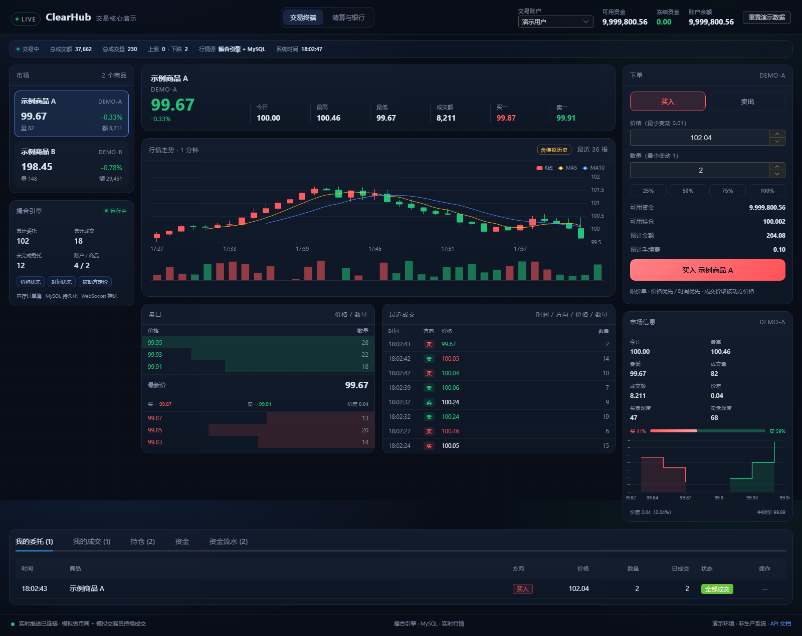
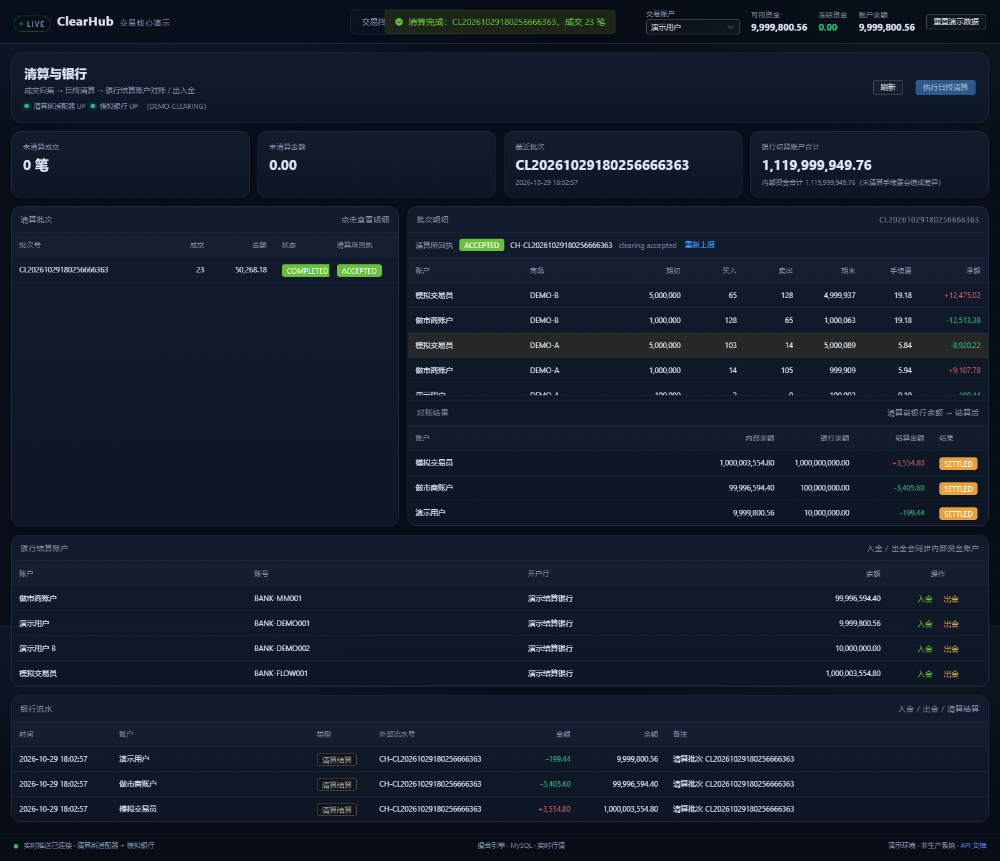

# ClearHub · 交易核心演示

一个可独立部署的现货交易核心演示：**下单 → 价格优先/时间优先撮合 → 成交 → 持仓 → 资金冻结/扣款/解冻**，附带模拟做市商、持续成交的模拟交易员、K 线/市场深度行情、实时盘口、交易终端和完整 Docker 部署。

> 本项目是从原有的银行/清算/交易系统中抽取撮合内核、重建外围后形成的可运行演示，不包含任何原公司的客户数据、真实银行凭据或内部网络地址。详见 [docs/COMPATIBILITY.md](docs/COMPATIBILITY.md)。





## 快速启动

```bash
cp .env.example .env      # 修改 MySQL 密码
docker compose up -d --build
```

打开 <http://localhost:8088>。首次启动会创建 22 张表、4 个演示账户、2 个商品，并由模拟做市商持续双边报价、模拟交易员持续成交；同时启动清算所适配器与模拟银行。

> 前端镜像使用仓库内已构建的 `web/dist` 静态产物。修改前端源码后，先执行 `cd web && npm ci && npm run build`，再 `docker compose up -d --build`。本机内存不足时，可用 `docker build -f web/Dockerfile.build -t clearhub-web-build web` 在 Node 22 容器内构建，再导出 `/app/dist`。

```bash
docker compose ps                  # 查看状态
docker compose logs -f trade-core  # 查看后端日志
python scripts/api-smoke.py --base-url http://127.0.0.1:8088
```

## 演示内容

| 能力 | 说明 |
|---|---|
| 撮合 | 价格优先、时间优先；成交价取被动方价格；支持部分成交 |
| 订单 | 买入/卖出、限价、撤单、涨跌停校验、最小变动单位校验 |
| 资金 | 下单冻结、成交扣款、撤单解冻、余额/冻结/可用、逐笔流水 |
| 持仓 | 买入增加持仓、卖出校验可用持仓、成本价与浮动盈亏 |
| 行情 | 最新价、开高低、成交量额、买卖盘口、最近成交、1 分钟 K 线 + 成交量 + MA5/MA10、市场深度图 |
| 实时 | WebSocket 推送盘口与成交；断线自动重连 + 轮询兜底；LIVE 状态与市场脉搏 |
| 做市 | 每 3 秒围绕参考价生成 3 档双边报价；模拟交易员每 2.5 秒穿越盘口下单，保证持续成交 |
| 清算 | 日终批次、按账户/商品归集买卖量额与手续费、生成清算明细 |
| 银行 | 银行结算账户、入金/出金、清算结算、账户对账与银行流水 |
| 适配器 | 独立 `clearing-adapter` 服务：请求号、幂等、清算所回执、部分失败状态 |
| 模拟银行 | 独立 `mock-bank` 服务：账户余额、入金/出金、清算调账、银行流水 |
| 运维 | 健康检查、演示数据一键重置、Docker Compose 一键部署 |

## 技术栈

- 后端：Spring Boot 2.7.18 / Java 17 / Spring Data JPA / MySQL 8 / WebSocket
- 前端：Vue 3 / Vite 5 / Element Plus / ECharts
- 通道：`clearing-adapter` + `mock-bank`（两个独立 Spring Boot 服务）
- 部署：Docker / Docker Compose / Nginx
- 测试：JUnit 5 / AssertJ / Awaitility / Playwright

## 仓库结构

```
trade-demo/
├─ src/main/java/com/clearhub/trade/
│  ├─ engine/        # 撮合引擎（纯 Java，可单测）
│  ├─ service/       # 下单、结算、资金、持仓、行情、做市、清算、银行、演示数据
│  ├─ integration/   # 清算所适配器客户端与 DTO
│  ├─ domain/        # 22 张表的 JPA 实体
│  ├─ repository/    # Spring Data JPA
│  ├─ web/           # REST 控制器
│  └─ websocket/     # 盘口/成交推送
├─ services/
│  ├─ clearing-adapter/  # 清算所适配器（8090）
│  └─ mock-bank/         # 模拟银行（8091，独立表）
├─ src/test/         # 撮合单测 + 订单链路 + 清算/银行集成测试
├─ db/init/          # MySQL 8 建表脚本（22 张表）
├─ db/migration/     # 已有库升级脚本
├─ web/              # Vue 3 交易终端（含预构建 dist）
├─ scripts/          # API 冒烟、UI 冒烟、重置脚本
├─ docs/             # 架构、接口、部署、演示、测试报告
├─ Dockerfile
└─ docker-compose.yml
```

## 本地开发

```bash
# 后端（H2 内存库，自动建表/种子数据）
mvn spring-boot:run -Dspring-boot.run.profiles=h2

# 前端（代理到 8080）
cd web && npm install && npm run dev
```

打开 <http://127.0.0.1:5173>。

## 测试

```bash
mvn test                                      # 14 个后端用例
python scripts/api-smoke.py --base-url ...    # 链路冒烟
python scripts/ui-smoke.py                    # Playwright 页面冒烟（需先启动前端）
```

结果见 [docs/TEST-REPORT.md](docs/TEST-REPORT.md)。

## 关键文档

- [架构与撮合规则](docs/ARCHITECTURE.md)
- [接口与 WebSocket 协议](docs/API.md)
- [5 分钟演示脚本](docs/DEMO.md)
- [服务器部署与运维](docs/DEPLOY.md)
- [测试报告](docs/TEST-REPORT.md)
- [验收清单](docs/ACCEPTANCE.md)
- [与原系统的差异](docs/COMPATIBILITY.md)
- [安全说明](SECURITY.md)

## 重要说明

这是**演示系统**，不是生产交易系统：

- 没有登录鉴权，`X-Firm-Id` 请求头可被伪造；
- 重置接口会清空全部交易、清算、银行与模拟银行数据；
- 清算所适配器与模拟银行为演示实现，不接真实银行/清算所，无签名/证书；
- 8090（适配器）、8091（模拟银行）只监听 Compose 内网，不要映射到宿主；
- 未实现真实交割、风控、审计、清算文件/SFTP；
- 仅支持现货买入/卖出，不支持杠杆、做空、期权等。

对外演示时请至少放在内网、VPN 或 HTTP Basic Auth 之后，并设置 `DEMO_RESET_ENABLED=false`。详见 [SECURITY.md](SECURITY.md)。
