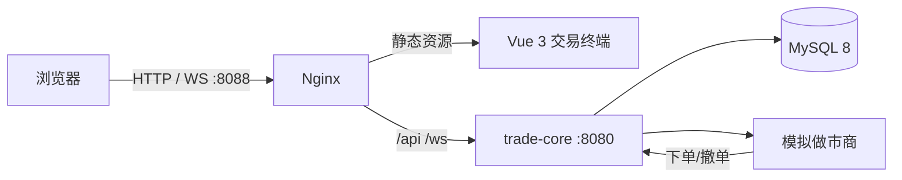
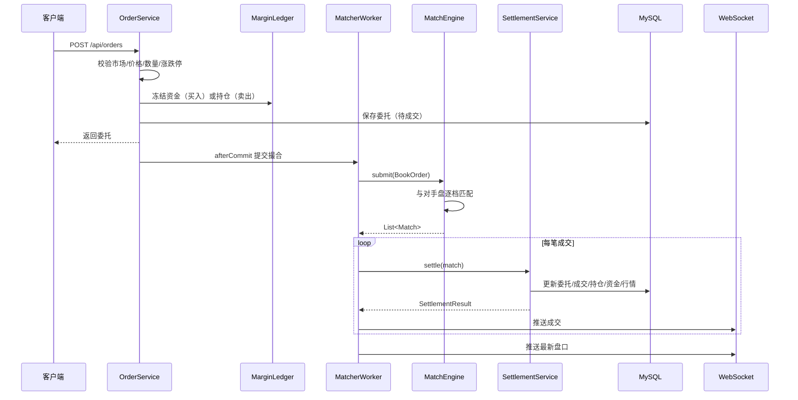

# 架构与撮合规则

## 1. 总览

单进程、单库，去掉了原系统的配置中心、注册中心、Redis、RabbitMQ 和微服务拆分，保留交易核心的三条主链路：

1. **下单**：校验 → 冻结资金/持仓 → 落库 → 提交撮合队列
2. **撮合**：每个商品一个撮合线程，价格优先/时间优先，成交价取被动方
3. **结算**：成交落库 → 更新委托/持仓/资金 → 更新行情 → WebSocket 推送

## 2. 代码分层

| 包 | 职责 |
|---|---|
| `engine` | 纯 Java 撮合引擎：`MatchEngine`、`MatcherWorker`、`BookOrder`、`Match`、`BookSnapshot` |
| `service` | `OrderService`（下单/撤单）、`SettlementService`（成交结算）、`MarginLedger`（资金）、`PositionService`（持仓）、`QuotationService`（行情）、`MatcherService`（撮合线程管理）、`MarketMakerService`（做市）、`DemoDataService`（种子/重置） |
| `domain` | 14 张表的 JPA 实体 |
| `repository` | Spring Data JPA，关键查询使用悲观锁 |
| `web` | REST 控制器，统一 `{code,message,data}` 响应 |
| `websocket` | `/ws/market`，按商品订阅盘口/成交 |

## 3. 撮合引擎

### 3.1 数据结构

- 买盘：`TreeMap<BookOrder, BookOrder>`，价格降序、同价 `orderId` 升序
- 卖盘：`TreeMap<BookOrder, BookOrder>`，价格升序、同价 `orderId` 升序
- 索引：`Map<orderId, BookOrder>`，用于 O(1) 撤单定位

### 3.2 撮合流程

### 3.3 规则

| 规则 | 实现 |
|---|---|
| 价格优先 | 买盘取最高买价，卖盘取最低卖价 |
| 时间优先 | 同价按 `order_id` 升序（入库顺序即时间顺序） |
| 成交价 | 取**被动方**（先挂单方）价格；买单高于卖一按卖一成交，卖单低于买一按买一成交 |
| 部分成交 | 成交后扣减内存剩余量；剩余继续挂单 |
| 自成交 | 默认禁止；若最优对手盘同 `firmId`，停止撮合，避免对倒 |
| 撤单 | 命令进入同一撮合队列，与撮合串行；撤单成功后才释放冻结 |
| 结算 | 在撮合线程内同步执行，单商品串行，保证簿记一致 |

> 同步结算会短暂阻塞该商品的撮合，但对演示流量足够；生产系统应改为成交队列 + 独立结算线程 + 幂等补偿。

## 4. 资金与持仓模型

本项目采用**现货全额冻结**模型：

- 买入：冻结 `价格 × 数量 × (1 + 手续费率)`；成交时按实际成交金额 + 手续费扣减，价差释放；撤单释放剩余冻结。
- 卖出：冻结可用持仓；成交时扣减持仓并增加资金（成交额 − 手续费）；撤单释放冻结持仓。
- 可用资金 = 余额 − 冻结资金；可用持仓 = 持仓 − 冻结持仓。
- 不做杠杆、不做卖空、不做逐日盯市；持仓成本价按买入成交加权平均。
- 手续费买卖双向收取，默认 `0.05%`，计入成交记录和资金流水。

资金流水业务码：

| 业务码 | 含义 |
|---|---|
| `ORDER_FREEZE` | 下单冻结 |
| `ORDER_CANCEL` | 撤单解冻 |
| `TRADE_BUY` | 买入成交扣款 |
| `TRADE_SELL` | 卖出成交入账 |

## 5. 数据模型

| 表 | 说明 |
|---|---|
| `base_market` | 市场 |
| `sec_commodity` | 商品与最小变动单位、涨跌停 |
| `sec_commodity_status` | 商品交易状态 |
| `sec_system_status` | 系统状态/当前交易日 |
| `sec_trade_day` | 交易日 |
| `firm` | 交易账户 |
| `dict_fu_symbol` | 币种 |
| `fu_account_funds` | 资金账户（余额/冻结/版本号） |
| `fu_account_funds_flow` | 资金流水 |
| `sec_order` | 委托 |
| `sec_trade` | 成交 |
| `sec_hold` | 持仓汇总 |
| `sec_hold_detail` | 买入持仓明细 |
| `sec_quotation` | 行情 |
| `trade_param` | 手续费率、单笔上限、涨跌停参数 |

> 原系统的 `sec_strategy_*` 8 张策略表被合并为 `trade_param`；原系统的 `clear_*`、`fb_*` 银行/清算表未纳入本演示。

## 6. 并发与事务

- 每个商品一个 `MatcherWorker` 线程，所有提交/撤单命令进入 `LinkedBlockingQueue` 串行执行。
- 下单：`OrderService.placeOrder` 在事务内完成校验、冻结、落库；`afterCommit` 再提交撮合，避免“未提交的订单被撮合”。
- 结算：`SettlementService.settle` 使用 `@Transactional`，对买卖委托、资金账户、持仓使用 `PESSIMISTIC_WRITE` 行锁。
- 查询：`MarketDataService` 只读，不加锁；盘口从撮合引擎内存快照读取。
- `TradeOrder`/`FundsAccount` 带 `@Version`，作为额外保护。

## 7. 模拟做市商

- 每 3 秒运行一次，按商品读取最新价，随机游走 ±0.4%。
- 以参考价为中心，按 `spreadTicks × 档位` 生成 3 档买卖报价，每档随机数量。
- 价格未变化时跳过，避免无意义刷单。
- 使用独立账户（默认 `firm_id=1`），与演示用户隔离；禁止自成交，因此不会自己和自己成交。
- 可通过 `DEMO_MM_ENABLED=false` 关闭。

## 8. 演示数据重置

`POST /api/demo/reset` 的执行顺序：

1. 停止所有撮合线程；
2. 清空做市商内存报价；
3. 删除成交、委托、持仓、资金、流水；
4. 重建 3 个账户的资金与持仓、重置行情；
5. 重启撮合线程。

重置后做市商会自动重新报价。该接口仅用于演示，生产环境应关闭。
